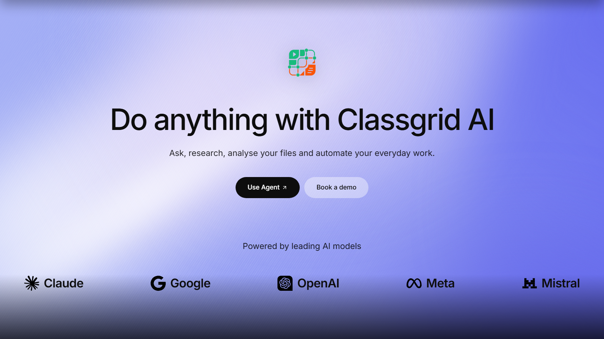
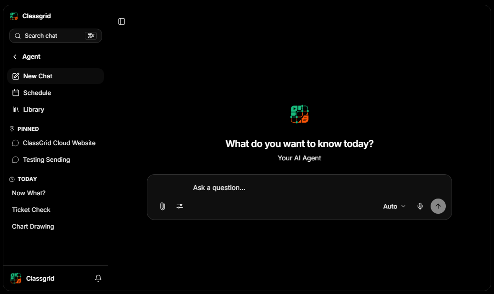

<!--
─────────────────────────────────────────────────────────
🚨 HOSTING & ARCHITECTURE RULE 🚨
1. BACKEND IS HOSTED ON AWS EC2 AT API.CLASSGRID.IN
2. FRONTEND IS HOSTED ON VERCEL
─────────────────────────────────────────────────────────
-->

<!--
─────────────────────────────────────────────────────────
🚨 NAMING CONVENTION RULE 🚨
1. "CLASSGRID PLATFORM" is strictly the REPO NAME.
2. chat.classgrid.in (Classgrid AI) is the actual PRODUCT. The ERP is shut down.
3. NEVER use "Classgrid Platform" anywhere in the frontend UI or user-facing text.
─────────────────────────────────────────────────────────
-->

<!--
─────────────────────────────────────────────────────────
🚨 CRITICAL AI AND SYSTEM RULES 🚨
1. NEVER DELETE ANY ENVIRONMENT VARIABLES.
2. LOCALHOST TESTING IS STRICTLY BANNED. NO AI WILL EVER TRY TO WORK LOCALLY.
3. THIS REPO IS PRODUCTION-FIRST. DO NOT TOUCH OR REMOVE KEYS.
─────────────────────────────────────────────────────────
-->

<div align="center">
  

  <h1>Classgrid AI</h1>

  <p><strong>Do anything with Classgrid AI.</strong><br />Ask, research, analyse your files and automate your everyday work.</p>

  <p>
    <a href="https://chat.classgrid.in">Open Classgrid AI</a>
    &middot;
    <a href="https://www.classgrid.in/agent">Agent</a>
    &middot;
    <a href="https://www.classgrid.in">Website</a>
    &middot;
    <a href="https://www.classgrid.in/blog">Blog</a>
    &middot;
    <a href="https://www.classgrid.in/changelog">Changelog</a>
    &middot;
    <a href="./CODE_OF_CONDUCT.md">Code of Conduct</a>
  </p>

  <p>
    
    
    
    
    
    
    
  </p>
</div>

<p align="center"><a href="https://www.classgrid.in/agent"></a></p>

---

**Classgrid AI** lives at **[chat.classgrid.in](https://chat.classgrid.in)**. It is one place to talk to an AI agent that can actually do the work, build inside your own code, and chat with the people you work with.

It has three parts:

| | What it is |
|---|---|
| **Agent Mode** | An AI agent that thinks, uses tools, runs code and shows every step live |
| **Project Mode** | The agent working inside your GitHub repository, with a browser IDE |
| **Grids** | Real-time chat with people: direct messages, groups, polls and files |

## Agent Mode

Ask in plain words and the agent works it out step by step. You can watch each step as it happens: what it searched, what code it ran, what it found.

<p align="center"><a href="https://chat.classgrid.in"></a></p>

- **Research:** searches the web, opens pages and cites its sources
- **Your files:** reads PDFs, Word, Excel, PowerPoint, CSV, images and audio; analyses spreadsheets and draws charts
- **Runs real code:** Python, Node.js and terminal commands in a private sandbox, then checks its own output
- **Makes things:** reports, PDFs, documents, images and websites, with a download link
- **Works with your apps:** reads and sends email, files, calendar events, Classroom work and more
- **Schedules:** daily briefs, weekly reports and reminders, by email and WhatsApp
- **Remembers:** finds earlier messages in long chats and keeps your files across the conversation

**Connected apps**

<p> &nbsp;  &nbsp;  &nbsp;  &nbsp;  &nbsp;  &nbsp;  &nbsp; </p>

**Models you can choose**

<p> &nbsp;  &nbsp;  &nbsp;  &nbsp;  &nbsp;  &nbsp;  &nbsp; </p>

## Project Mode

The agent works inside **your own GitHub repository**.

- Connect GitHub, pick a repo, and the agent explores, edits files and runs commands in it
- Each user gets their own private workspace and browser IDE; nothing is shared between users
- Review every change (files edited, lines added and removed), then push to GitHub

## Grids

Real-time chat built into Classgrid AI.

- Direct messages and group chats with live updates and unread counts
- Polls, announcements, file and voice-note sharing, message forwarding
- The agent can read and send Grid messages for you when you ask

## Open-source agent harness

The **agent harness** is the engine behind Classgrid AI: the loop that lets the model think, call tools, run code in a sandbox, check its own work and stream every step to the chat live. We are building it in the open.

- The harness and this repository are open source under the **[MIT License](./license.md)**
- You are free to use, copy, modify and build on it, as long as the license notice stays with it

## Repository Map

```text
classgrid_platform/
|-- client/                  # React 19 + Vite web app (chat.classgrid.in)
|   `-- src/components/ai/   # Agent chat, step views, Project Mode UI
|-- server/                  # Node.js + Express API (api.classgrid.in)
|   |-- src/controllers/     # Agent chat loop and request handlers
|   |-- src/services/        # Model streaming, tools, billing, integrations
|   |-- src/mcp/             # Tool definitions the agent can call
|   `-- src/routes/          # API routes (chat, Grids, voice, connectors)
|-- ai-sandbox-worker/       # Sandbox worker used to run the agent's code
|-- packages/                # Shared packages
|-- docs/                    # Architecture notes
`-- README.md
```

## Technology Stack

- **Frontend:** React 19, Vite, TypeScript, Tailwind CSS, Framer Motion, React Markdown, KaTeX, Mermaid
- **Backend:** Node.js, Express, MongoDB, Supabase, Redis, BullMQ, Socket.IO
- **Agent:** streaming tool-use loop across Claude, DeepSeek, GLM, Kimi, Qwen, Mistral and other models; Docker sandbox for code; Cloudflare R2 CDN for files
- **Hosting:** frontend on Vercel, backend on AWS EC2 with PM2 and Nginx

## Local Development

### Prerequisites

- Node.js 18 or newer
- npm
- MongoDB connection string
- Redis instance when testing workers, queues, realtime scaling, or rate-limit backed flows
- Supabase project credentials for modules that use Supabase
- Firebase credentials for Firebase-backed features
- Provider credentials for OAuth, AI, email, SMS, video, and payments as needed

### Install

```bash
npm run install:all
```

### Run full stack

```bash
npm run dev
```

This starts the backend and frontend from the root workspace using the existing root scripts.

### Run individually

```bash
npm run dev:server
npm run dev:client
```

### Build frontend

```bash
cd client
npm run build
```

### Start backend directly

```bash
cd server
npm start
```

## Environment Variables

Never commit real environment files or credentials. The local backend file is `server/.env`, and it must stay only on the developer machine or EC2 instance. The repository `.gitignore` excludes local env files, build outputs, logs, private keys, and sensitive service-account JSON.

Minimum production backend variables:

```text
MONGO_URI
JWT_SECRET
COOKIE_SECRET
NODE_ENV
PORT
```

Common backend variables by area:

```text
APP URLS:
BACKEND_URL
CLIENT_URL
FRONTEND_URL
PUBLIC_SITE_URL
MARKETING_SITE_URL

DATABASE AND CACHE:
MONGO_URI
MONGODB_URI
REDIS_URL

SUPABASE:
SUPABASE_CHAT_URL
SUPABASE_CHAT_KEY
CLASSROOM_SUPABASE_URL
CLASSROOM_SUPABASE_SERVICE_ROLE_KEY
BLOG_SUPABASE_URL
BLOG_SUPABASE_SERVICE_ROLE_KEY

AUTH AND OAUTH:
JWT_SECRET
COOKIE_SECRET
SUPER_ADMIN_EMAIL
GOOGLE_CLIENT_ID
GOOGLE_CLIENT_SECRET
GOOGLE_CALLBACK_URL
GOOGLE_CALLBACK_URL_PROD
GITHUB_CLIENT_ID
GITHUB_CLIENT_SECRET
GITHUB_CALLBACK_URL
FACEBOOK_CLIENT_ID
FACEBOOK_CLIENT_SECRET
FACEBOOK_CALLBACK_URL
LINKEDIN_CLIENT_ID
LINKEDIN_CLIENT_SECRET
LINKEDIN_CALLBACK_URL

EMAIL:
BREVO_SMTP_HOST
BREVO_SMTP_PORT
BREVO_SMTP_USER
BREVO_SMTP_PASS
BREVO_SENDER_NAME
BREVO_SENDER_EMAIL

AI:
OPENAI_API_KEY
ANTHROPIC_API_KEY
GEMINI_API_KEY
GROQ_API_KEY
HUGGINGFACE_API_KEY

COMMUNICATION AND VIDEO:
AGORA_APP_ID
AGORA_APP_CERTIFICATE
AGORA_CUSTOMER_ID
AGORA_CUSTOMER_SECRET
ZOOM_CLIENT_ID
ZOOM_CLIENT_SECRET
ZOOM_REDIRECT_URI
ZOOM_WEBHOOK_SECRET_TOKEN
AWS_SNS_ACCESS_KEY_ID

PAYMENTS:
RAZORPAY_KEY_ID
RAZORPAY_KEY_SECRET

STORAGE AND SECURITY:
AWS_ACCESS_KEY_ID
AWS_SECRET_ACCESS_KEY
S3_BUCKET_NAME
FIREBASE_SERVICE_ACCOUNT_JSON
ENCRYPTION_KEY
CRON_SECRET
TURNSTILE_SECRET_KEY
CLOUDFLARE_TURNSTILE_SECRET_KEY
```

Common frontend variables:

```text
VITE_API_BASE_URL
VITE_MOCK_API
VITE_SUPABASE_URL
VITE_SUPABASE_ANON_KEY
NEXT_PUBLIC_SUPABASE_URL
NEXT_PUBLIC_SUPABASE_ANON_KEY
VITE_FIREBASE_API_KEY
VITE_FIREBASE_AUTH_DOMAIN
VITE_FIREBASE_PROJECT_ID
VITE_FIREBASE_STORAGE_BUCKET
VITE_FIREBASE_MESSAGING_SENDER_ID
VITE_FIREBASE_APP_ID
```

Only variables intended for browser exposure should use `VITE_` or `NEXT_PUBLIC_` names. Backend secrets must stay server-side.

## EC2 Deployment Notes

The backend is designed to run on AWS EC2 as a Node.js service managed by PM2. A typical production EC2 setup is:

```text
User: ubuntu
Application path: /home/ubuntu/classgrid/current
Backend path: /home/ubuntu/classgrid/current/server
PM2 app name: classgrid
Backend port: 3000
Health check: http://localhost:3000/api/health
Logs: /home/ubuntu/classgrid/logs and server/logs
```

Recommended EC2 production flow:

```bash
cd /home/ubuntu/classgrid/current
git pull origin main

cd server
npm ci --production
pm2 reload ecosystem.config.cjs --env production --update-env
pm2 save
```

Recommended Nginx shape:

```text
HTTPS request
-> Nginx reverse proxy
-> http://127.0.0.1:3000
-> Express API
```

Operational checks after deployment:

```bash
pm2 status
pm2 logs classgrid --lines 50
curl -i http://localhost:3000/api/health
```

Environment setup on EC2:

- Keep `server/.env` on the EC2 machine only.
- Do not place production secrets in GitHub, README files, screenshots, issue comments, or commit messages.
- Rotate credentials immediately if a secret is ever exposed.
- Keep Nginx, PM2, Node.js, and system packages updated.
- Use HTTPS for public traffic and keep security groups limited to required ports.

## Git and Source-Control Rules

- This repository is open source under the MIT License; secrets and production config never are.
- Do not commit `.env`, secret JSON, private keys, generated logs, build outputs, or temporary screenshots.
- Review `git status --short` before every commit.
- Use `git check-ignore -v server/.env` before pushing when working near backend secrets.
- Prefer small, meaningful commits when possible.
- Use clear commit messages that describe product or engineering changes without exposing credentials.

## Conduct and Collaboration

All contributors must follow the [Classgrid Code of Conduct](./CODE_OF_CONDUCT.md). It covers professional collaboration, confidentiality, secret handling, private-repository access, security escalation, and enforcement expectations for Classgrid work.

## Deployment Targets

The codebase supports multiple runtime surfaces:

- Local development from the monorepo root
- Vite frontend builds from `client/`
- Node/Express backend from `server/`
- EC2 backend runtime with PM2 and Nginx
- Vercel-style frontend or API deployment surfaces where configured
- Expo/EAS mobile builds from `mobile/`

## Security Checklist

Before pushing or deploying:

- Confirm `server/.env` is ignored.
- Confirm no secret values appear in staged files.
- Confirm no service-account JSON, PEM, private key, or local token file is staged.
- Confirm production environment variables are set on EC2 or the deployment platform.
- Confirm `NODE_ENV=production` for production backend runtime.
- Confirm `/api/health` returns a healthy response after deploy.

## License

Classgrid AI and its agent harness are open source under the **MIT License**. See [license.md](./license.md).

Copyright (c) 2026 Classgrid.
